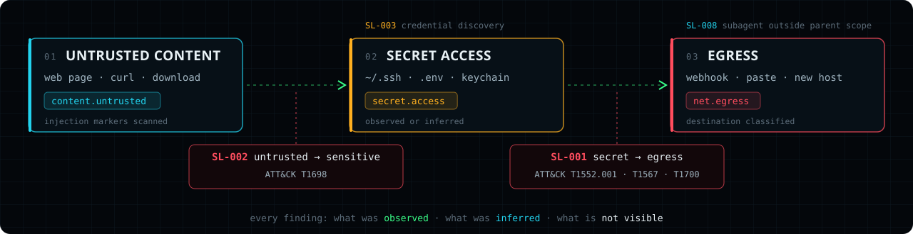
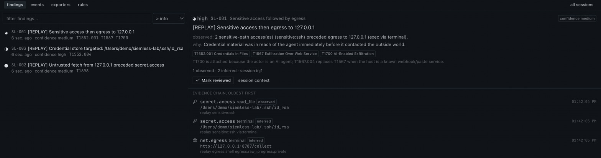
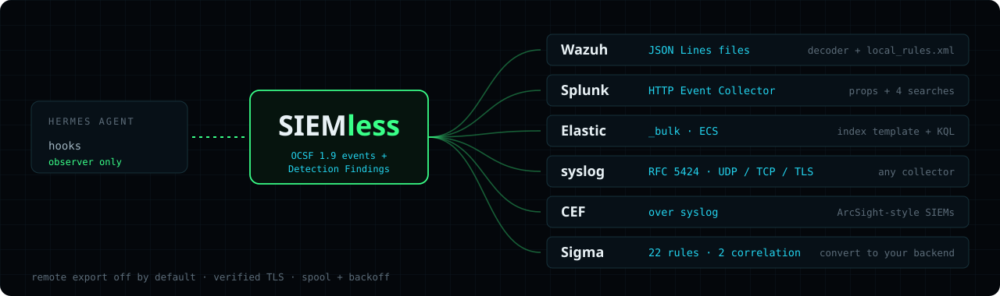

<p align="center">
  
</p>

<p align="center">
  <a href="https://github.com/ASV-Labs/siemless/releases"></a>
  <a href="https://github.com/ASV-Labs/siemless/actions/workflows/ci.yml"></a>
  
  
  
  <br>
  
  
  
  <a href="LICENSE"></a>
</p>

<h3 align="center">Your SIEM sees your servers. It doesn't see your agent.</h3>

<p align="center">
SIEMless turns every tool call, file read, shell command, outbound request, approval, subagent, scheduled job
and config change a Hermes agent makes into an <b>OCSF 1.9 security event</b> — then correlates them into
<b>ATT&amp;CK-mapped findings</b> your SOC can act on. Observer hooks only. Nothing blocked, nothing rewritten,
nothing leaves the machine until you say so.
</p>

```bash
hermes plugins install ASV-Labs/siemless
```

> [!NOTE]
> Hermes ≥ 0.21.5 · Python standard library only (FastAPI, already in Hermes, serves the Desktop page).
> Upstream `hermes plugins validate`: **16/16**. The security scan says *caution* and the installer asks you to
> confirm (`[y/N]`, or `--force` when scripted) — what it flags are SIEMless's own detection patterns. See [Disclosure](#disclosure).
> Once the catalog listing is live: `hermes plugins install siemless`.

> [!TIP]
> **Updating from the CLI?** Hermes Desktop serves its own copy of the SIEMless page and does not refresh it on a
> CLI install or update. Press **Rescan** in Capabilities › Plugins, or restart Hermes Desktop. Until then the page
> tells you which version it is and which the agent runs.

## `01` The chain it catches

<p align="center"></p>

A page tells the agent to read a key and post it somewhere. Each step is an event; the sequence is a finding.
Every finding says what was **observed**, what was **inferred**, which ATT&CK techniques apply, what to do —
and what SIEMless **could not see**.

## `02` Sixty seconds

<p align="center"></p>
<p align="center"></p>

That is a **replay** of a recorded session, labelled `[REPLAY]` everywhere it appears and never sent to a remote
exporter. SL-001's confidence is low on purpose: the egress came from command text, and SIEMless says so
rather than presenting an inference as a fact.

`demo/` has a local lab (injection page, canary key, collector and receiver on 127.0.0.1) and eight
recorded variants for deterministic replay. Read [demo/README.md](demo/README.md): if the model refuses
the injected instruction, that is the honest result, and the pipeline demo is the replay.

## `03` In Hermes Desktop

<p align="center"></p>

Findings with their evidence chains, the raw events, exporter health and the ruleset — plus a status-bar chip
and a toast on anything high or critical. Everything also works from the CLI:
`/siemless status · findings · show · tail · rules · hosts · ack · test-exporter · replay` (or `hermes siemless …`, `--json`).

## `04` Where it goes

<p align="center"></p>

| | |
|---|---|
| **Events** | ~20 kinds (`secret.access`, `net.egress`, `process.exec`, `config.change`, `approval.response`, `subagent.start` …), each with correlation ids and a visibility label. [docs/EVENTS.md](docs/EVENTS.md) |
| **Findings** | SL-001 … SL-014: what was observed, why it matters, ATT&CK technique and tactic, what is *not* visible, what to do. [Rules](#05-the-rules) |
| **Exports** | `events.jsonl` + `findings.jsonl` (OCSF, ECS or canonical) · syslog UDP/TCP/TLS · CEF · Splunk HEC · Elastic `_bulk` · a JSON receiver contract for your own wall. |
| **Packs** | [Wazuh](docs/integrations/wazuh) `<localfile>` + `local_rules.xml` (ids 100500–100599) · [Splunk](docs/integrations/splunk) props + SPL · [Elastic](docs/integrations/elastic) index template + KQL · [Sigma](docs/integrations/sigma): 14 finding rules, 6 raw-event rules, 2 correlation rules · [your own wall](docs/integrations/summit.md). |

## `05` The rules

| id | name | fires on | ATT&CK |
|---|---|---|---|
| SL-001 | Sensitive access followed by egress | secret read → external destination within the window (webhook → critical) | T1552.001, T1567 / .004, T1700 |
| SL-002 | Untrusted content followed by sensitive action | fetch/browse/download → credential access, new host, config or cron change | T1698 |
| SL-003 | Credential discovery | SSH keys, cloud creds, .env, keychain, browser stores, token-fetching CLIs | T1552.*, T1555.* |
| SL-004 | First-seen destination near sensitive activity | a host this profile never contacted, after a secret or config event | T1071.001, T1567 |
| SL-005 | Scheduled job or persistence created | Hermes cron, crontab, launchctl, systemd (high when tainted) | T1053 / .003 |
| SL-006 | Plugin or skill set changed | install/enable/remove (high when tainted or from a subagent) | none exact (T1195 noted) |
| SL-007 | Approval anomaly | 3 denials / 5 min, 6 prompts / 1 min, or a retry after a denial | behavioural |
| SL-008 | Subagent outside parent scope | child does what the parent never did in the window | carries the action's mapping |
| SL-009 | Suspicious command shape | decode-and-run, download-and-run, reverse shells, setuid, history tampering | T1059.004, T1027, T1140, T1105, T1070.003, T1690 |
| SL-010 | Security configuration or instruction file changed | Hermes config/.env/hooks, approval mode, SOUL.md/AGENTS.md, shell rc, SSH authorized keys | T1685 / .007, T1546.004, T1098.004 |
| SL-011 | Code published after sensitive access | git push / gh publish after a credential read | T1567.001 |
| SL-012 | Data sent to a webhook or paste service | Discord/Slack webhooks, webhook.site, ngrok, pastebin, interact.sh … | T1567.004 / .003 |
| SL-013 | Message or delegation after sensitive access | send_message or subagent spawn after a credential read | T1041 (approximate) |
| SL-014 | Hermes's own secrets or another profile | `.hermes/.env`, `auth.json`, another profile's home | T1552.001 |

ATT&CK names, tactics and URLs come from the bundled Enterprise 20.1 excerpt
(`siemless_core/data/attack.json`); a test fails if a rule names a technique that is missing or
revoked. (T1562.001, the usual id for "disable security tools", is revoked in v20 — SIEMless emits
its replacement T1685 and the agent-specific T1685.007.)

## `06` Where it fits

SIEMless records what the agent did and hands it to the SIEM you already run. It does not scan your
code, run scanners or block anything, so it sits beside the plugins that do:

| Plugin | Its job | With SIEMless |
|---|---|---|
| `hermes-security` (official) | Reviews a repository for vulnerabilities; reports as SARIF, JSON, CSV, Markdown | Reviews code. SIEMless watches the agent that runs it |
| `airlock`, `tirith`, `canary-trap`, `blackbox`, `hermes-tenuo` | Gate or refuse tool calls | They enforce, SIEMless records. Calls a guard sends to Hermes's approval prompt (airlock, tirith) land as `approval.request` / `approval.response` events |
| SOC toolkits (e.g. `warden`, `hermes-cyber-au`) | Give the agent defensive tools: scanning, host telemetry, hunts | They make the agent an analyst. SIEMless makes the agent something your analysts can see |

What SIEMless adds: OCSF 1.9 events about the agent itself, ATT&CK-mapped findings with an evidence
chain, and ready packs for Wazuh, Splunk, Elastic, syslog and CEF, with no binaries to install and no
network until you turn export on.

## `07` How it works

<details>
<summary><b>Pipeline, delivery guarantees, correlation, injection markers, suppression, cost</b></summary>

```
Hermes observer hooks ──▶ collect() ──▶ bounded queue ──▶ worker thread
   post_tool_call             │                              │
   pre/post_approval_*        │  redact · bound · classify   ├─▶ SQLite (0600)   ──▶ Desktop page, /siemless
   subagent_start/stop        │                              ├─▶ correlate (session · turn · delegation tree)
   post_api_request …         └─ microseconds on the         ├─▶ 14 rules ──▶ findings
                                 agent thread                └─▶ dispatcher ──▶ jsonl · syslog · CEF · HEC · Elastic · receiver
                                                                   (bounded queue · per-exporter spool · backoff · health)
```

* The agent thread only reduces the payload and enqueues. A full queue drops the oldest event and
  counts it; it never blocks.
* A dead destination never breaks a session: batches spool to disk (bounded), retry with capped
  backoff, and replay in order on recovery. A refusal (401/403, a missing token, a redirect) keeps
  the events in the spool, retries every 5 minutes instead of hammering, and shows `refused` with
  the reason in health. Tokens are resolved lazily, so a token set after start is picked up.
  Delivery is **at-least-once**; every event carries its id for dedupe.
* Rules read a correlation window (default 10 min) keyed on event *time*, so a late callback still
  joins what preceded it. Sessions are never merged; a subagent inherits its parent's taint.
* Security-relevant events (secret reads, egress, config changes, untrusted content) are also kept in
  their own ring, so a flood of routine calls cannot push a secret read out of the window.
* Fetched pages, browser reads and downloaded files are scanned (first 64 KB, nothing stored) for a
  handful of injection markers — orders to discard earlier instructions, text addressed to the agent, asks
  for key files, `curl | sh`, hidden HTML, invisible characters. A tainted governance change or
  credential access is *critical* only when the content carried markers; a plain docs fetch followed
  by a config edit is *high* (ordinary research looks like that too).
* Tools SIEMless has no dedicated collector for (MCP servers, other plugins) still produce file,
  secret, config and egress events: every string argument that looks like a path or URL is
  classified (bounded), whatever the argument is called, and the events are labelled *inferred*.
* A credential read followed only by a reply on the agent's own chat channel is SL-001 *medium*,
  not high; SL-013 covers chat-channel exfiltration and escalates on message size.
* Suppression: `allow_hosts`, `allow_paths` (prefixes match whole path segments after
  normalisation, so `proj/../.ssh` is not inside `proj`), `disable_rules`, and a per-rule dedupe
  cooldown that never masks an escalation (a later, more severe finding of the same kind fires).
* Measured (`tests/bench.py`, this sandbox, after the round-1 fixes): a hook callback costs the
  agent thread ~0.5 ms at p50 and under 1 ms at p95 whether the tool result is 1 KB or 1 MB; a 1 MB
  `write_file` argument costs ~1.5 ms (only the first ~2 KB are redacted and scanned). Worker latency
  from event in to finding out is ~1 ms p50. Your numbers show in `/siemless status`.

</details>

## `08` Configuration

<details>
<summary><b>All settings</b> — safe defaults: local JSONL on, remote export off, prompts hashed, arguments bounded and redacted</summary>

All keys live under `plugins.entries.siemless.settings` (Desktop → Settings → Plugins → SIEMless,
or `hermes config set plugins.entries.siemless.settings.<key> <value>`). Defaults are safe: local
JSONL on, remote export off, prompts hashed, arguments bounded and redacted. Turning `remote_export`
off, or clearing a destination, reaches a running agent within seconds. Adding or changing a
destination needs a gateway restart. A cloned profile keeps its source's export settings, so check
them before you use the clone. Hermes Desktop loads one copy of the page for all profiles, so after an
upgrade update every profile that has the plugin and reopen Desktop; `hermes plugins doctor` warns
if Desktop is running a stale copy.

| key | default | |
|---|---|---|
| `export_scope` | `security` | `findings` · `security` (findings + security-relevant events) · `all` |
| `remote_export` | `false` | consent gate: no syslog/HEC/Elastic/receiver traffic until true |
| `jsonl_enabled` / `jsonl_format` / `jsonl_path` / `jsonl_max_mb` | on · ocsf · plugin-data · 50 | the files Wazuh reads |
| `syslog_target` / `syslog_format` / `syslog_ca_file` | off | `udp://h:514`, `tcp://h:6514`, `tls://h:6514`; MSG = ocsf/ecs/canonical/cef |
| `hec_url` / `hec_index` / `hec_sourcetype` / `hec_format` | off | token in `SIEMLESS_HEC_TOKEN` (via Hermes) |
| `elastic_url` / `elastic_data_stream` | off | key in `SIEMLESS_ELASTIC_API_KEY` |
| `summit_url` | off | token in `SIEMLESS_SUMMIT_TOKEN`; [contract](docs/integrations/summit.md) |
| `http_ca_file` | — | a private CA for the HTTPS exporters (verification is never disabled) |
| `window_minutes` / `finding_cooldown_s` | 10 · 600 | correlation window; same finding at most once per cooldown |
| `allow_hosts` / `allow_paths` / `disable_rules` | — | suppression |
| `approval_denies` / `approval_burst` | 3 · 6 | SL-007 thresholds |
| `record_args` / `record_prompts` / `record_aux_calls` | true · false · true | what is kept |
| `retention_days` / `max_events` / `queue_size` / `spool_max_mb` | 30 · 200k · 10k · 20 | bounds |
| `watch_private_hosts` / `allow_loopback_http` | false · false | lab switches, see [demo/README.md](demo/README.md) |

The full list with descriptions is `plugin.yaml` → `config_schema`, generated from
`siemless_core/config.py` (a test keeps them identical).

</details>

## `09` Privacy and permissions

**What is stored.** Event metadata: kinds, tool names, paths, hosts, URLs with credentials and
secret-named query parameters masked, the first redacted line of a command, status, durations,
correlation ids, token counts. **Never** stored: prompt text, model output, tool results, file
bodies, message text. Secrets are masked by pattern wherever text is kept (arguments, argument
names, commands, URLs, reasons, kanban fields); a secret no pattern recognises can still be stored,
which is why the patterns and the canary set grow with every audit. User messages and subagent goals are recorded as a hash and a
length (`record_prompts: true` adds a 200-character redacted preview). Tool arguments are bounded
to ~1.5 KB per call (strings, dicts and lists share one budget) and redacted with patterns for
vendor key prefixes (Anthropic, OpenAI, GitHub, AWS incl. STS, Stripe, SendGrid, DigitalOcean,
Grafana, Linear, Slack, Atlassian, Netlify, Pulumi, age …), `key=value` secrets (quoted or not),
CLI credential flags (`curl -u`, `--password`, `mysql -p`, `sshpass -p`, `redis-cli -a`), npm
`_authToken`/`_auth`, `.netrc` `password` words, bearer tokens, PEM blocks
of any length, URL credentials, query-string secrets, Slack/Discord/Office webhook paths and
Telegram bot-token paths (adapted from lineage, same author). Redaction runs before any cut. A
canary test proves none of 27 synthetic secret shapes reaches the store, the exports or any
rendered format.

**Where.** `<HERMES_HOME>/plugin-data/siemless/`: `siemless.db` (0600, in a 0700 dir), `events.jsonl`,
`findings.jsonl`, `spool/`. Retention by age and count.

**Outbound.** Zero by default. With `remote_export: true` and a destination configured, the
configured syslog/HEC/Elastic/receiver endpoints receive the events in `export_scope`; TLS is
verified against the system store or your `http_ca_file`/`syslog_ca_file`, and there is no option
to disable verification. Redirects are never followed, so a token cannot be carried to another
host. Tokens are read through `agent.secret_scope.get_secret`, never from `.env`. **Replays**
(`siemless replay`, the dashboard's replay) are tagged `replay` in every format, titled
`[REPLAY]`, correlated in their own namespace, and never sent to a remote exporter.

### Disclosure

Observer hooks only (`on_session_*`, `pre/post_llm_call`, `post_api_request`, `api_request_error`,
`post_auxiliary_call`, `post_tool_call`, `pre_approval_request`, `post_approval_response`,
`on_human_input_*`, `subagent_start/stop`, `pre_command`, `on_skill_lifecycle`, kanban observers);
no `pre_tool_call`, no middleware, no tools, nothing blocked or rewritten. Reads: the hook payloads
Hermes passes (bounded and redacted before storage). Writes: its own SQLite database, JSONL files
and spool under `plugin-data/siemless/`, all `0600`. Network: none unless `remote_export` is true
*and* a destination is set, then only to those destinations over verified TLS (UDP/TCP syslog if
you choose them; plain HTTP to 127.0.0.1 only with the lab switch). Background work: one daemon
worker thread per process for the pipeline, one for dispatch, and one that rereads the delivery
settings every 5 seconds. No shell commands, no
credentials read from files, no telemetry to ASV Labs, no self-updater. The install scanner
reports *caution* because the detector lists the very patterns it looks for (ssh directories,
webhook hosts, `curl | sh`, cron, env dumps) in `siemless_core/sensitive.py` and in the tests.

## `10` What it will not do

* It does not stop anything. Pair it with a guard plugin (airlock, tenuo, jev-judge, camel-guard)
  for enforcement; their blocks show up here as `tool.call … blocked` with the `security_control`
  profile.
* It does not see the OS. A shell command's network call or file read is inferred from the
  command text; `docs/EVENTS.md` lists exactly what is observed, inferred and unavailable.
* It does not keep the injected text. It scans fetched content for a few marker shapes and records
  only which markers matched; the transcript holds the words. No markers proves nothing.
* One pipeline per process. Under a gateway that multiplexes several profiles in one process, events
  are filed under the first profile that loaded the plugin (not yet tested against a multiplexed
  gateway).

## `11` Development

<details>
<summary><b>Tests, packs, schema checks, audits</b></summary>

```
python -m pytest -q tests                       # rules, formats (OCSF validated against the 1.9.0 schema), dispatch, privacy canaries, API, demo variants, packs, audit regressions
cd tests/js && npm install && npm test          # Desktop page rendered against real backend fixtures (tests/js/make_fixtures.py)
python tests/bench.py                           # agent-thread cost and detection latency
python tools/gen_sigma.py                       # regenerate the Sigma pack
python tools/ocsf_check.py --schema <ocsf-schema checkout> --compile siemless_core/data/ocsf_required.json
hermes plugins validate .                       # upstream's admission checks; CI runs them against current Hermes main
```

Independent audits: [audit/round1.md](audit/round1.md) (5 high, 14 medium, 9 low) and
[audit/round2.md](audit/round2.md) (2 high, 2 medium). All fixed; every finding has a regression
test (`tests/test_audit_round1.py`, `tests/test_round1_fixes.py`, `tests/test_audit_round2.py`).

Research behind the shapes and mappings, with sources and what remains unverified:
[docs/RESEARCH.md](docs/RESEARCH.md). Baseline state when the build started: [docs/BASELINE.md](docs/BASELINE.md).

</details>

<p align="center"></p>
