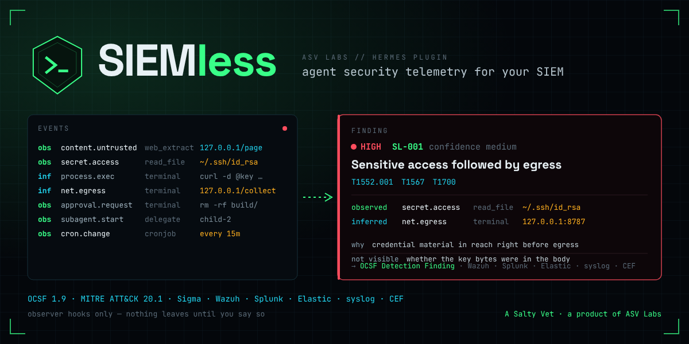

<p align="center">
  
</p>

# SIEMless

**Agent security telemetry for your SIEM.** Every tool call, file read, shell command, outbound
request, approval, subagent, scheduled job and configuration change a Hermes agent makes becomes an
OCSF 1.9 security event. Fourteen deterministic rules correlate them into findings — secret access
then egress, prompt-injection chains, credential discovery, persistence, governance tampering —
with MITRE ATT&CK 20.1 mapping and evidence labelled *observed* or *inferred*, never blended.
Exports as JSON Lines (Wazuh), RFC 5424 syslog, CEF, Splunk HEC and Elastic ECS, with a pack for each.

Observer hooks only. Nothing is blocked, nothing is rewritten, and nothing leaves the machine
until you say so.

```
hermes plugins install siemless
```

> Hermes ≥ 0.21.5. Python standard library only; FastAPI (already in Hermes) for the Desktop
> page's backend. `hermes plugins validate`: 0 desktop-surface refusals, 0 core overrides.

## What you get

| | |
|---|---|
| **Events** | ~20 kinds (`secret.access`, `net.egress`, `process.exec`, `config.change`, `approval.response`, `subagent.start` …), each with correlation ids and a visibility label. [docs/EVENTS.md](docs/EVENTS.md) |
| **Findings** | SL-001 … SL-014, each stating what was observed, why it matters, the ATT&CK technique and tactic, what is *not* visible, and what to do. [Rules](#the-rules) |
| **Exports** | `events.jsonl` + `findings.jsonl` (OCSF, ECS or canonical) · syslog UDP/TCP/TLS · CEF · Splunk HEC · Elastic `_bulk` · a JSON receiver contract for your own wall. [docs/integrations](docs/integrations) |
| **Packs** | Wazuh decoder notes + rules XML · Splunk props + SPL · Elastic index template + KQL · 22 Sigma rules incl. 2 correlation rules. |
| **Desktop** | A SIEMless page: findings with evidence chains, events, exporter health, the ruleset; a status-bar chip; a toast on high/critical. |
| **CLI** | `/siemless status · findings · show · tail · rules · hosts · ack · test-exporter · replay`, and the same as `hermes siemless …` (`--json`). |

## Sixty seconds

```
$ hermes siemless replay demo/fixtures/1_injection_succeeds.jsonl
replayed 5 records in 31 ms → 3 finding(s)  [REPLAY, not live]
22:07:12  high     medium SL-002  Untrusted fetch from 127.0.0.1 preceded secret.access  [4e1c8a0b]
22:07:12  medium   high   SL-003  Credential store targeted: /Users/demo/siemless-lab/.ssh/id_rsa  [9bd0f3e2]
22:07:13  high     low    SL-001  Sensitive access then egress to 127.0.0.1  [c21a77d5]

$ hermes siemless show c21a
SL-001 Sensitive access followed by egress — high / confidence low  id c21a77d5…
observed: 1 sensitive-path access(es) (sensitive:ssh) preceded a exec to 127.0.0.1 via terminal.
why: Credential material was in reach of the agent immediately before it contacted the outside world.
ATT&CK: T1552.001 Credentials In Files, T1567 Exfiltration Over Web Service, T1700 AI-Enabled Exfiltration
visibility: 1 observed, 1 inferred
evidence:
  22:07:12  observed  secret.access      read_file      /Users/demo/siemless-lab/.ssh/id_rsa
  22:07:13  inferred  net.egress         terminal       http://127.0.0.1:8787/collect
not visible: File contents are never recorded … Shell network calls are inferred from command text …
recommendation: Check whether the destination is one you expect for this task; rotate the credentials named …
```

Confidence is **low** there on purpose: the egress came from command text, and SIEMless says so
rather than presenting an inference as a fact.

## How it works

```
Hermes observer hooks ──▶ collect() ──▶ bounded queue ──▶ worker thread
   post_tool_call             │                              │
   pre/post_approval_*        │  redact · bound · classify   ├─▶ SQLite (0600)   ──▶ Desktop page, /siemless
   subagent_start/stop        │                              ├─▶ correlate (session · turn · delegation tree)
   post_api_request …         └─ microseconds on the         ├─▶ 14 rules ──▶ findings
                                 agent thread                └─▶ dispatcher ──▶ jsonl · syslog · CEF · HEC · Elastic · receiver
                                                                   (bounded queue · per-exporter spool · backoff · health)
```

* The agent thread only reduces the payload and enqueues. A full queue drops the oldest event and
  counts it; it never blocks.
* A dead destination never breaks a session: batches spool to disk (bounded), retry with capped
  backoff, and replay in order on recovery. A refused token stops retries and shows in health.
  Delivery is **at-least-once**; every event carries its id for dedupe.
* Rules read a correlation window (default 10 min) keyed on event *time*, so a late callback still
  joins what preceded it. Sessions are never merged; a subagent inherits its parent's taint.
* Suppression: `allow_hosts`, `allow_paths`, `disable_rules`, and a per-rule dedupe cooldown.
* Measured (`tools/bench.py`, this sandbox): a hook callback costs the agent thread ~0.4 ms at p50
  and under 1 ms at p95 whether the tool result is 1 KB or 1 MB; a 1 MB `write_file` argument costs
  ~0.3 ms (only the first few KB are scanned). Worker latency from event in to finding out is
  ~0.5 ms p50. Your numbers show in `/siemless status`.

## The rules

| id | name | fires on | ATT&CK |
|---|---|---|---|
| SL-001 | Sensitive access followed by egress | secret read → external destination within the window (webhook → critical) | T1552.001, T1567 / .004, T1700 |
| SL-002 | Untrusted content followed by sensitive action | fetch/browse/download → credential access, new host, config or cron change | T1698 |
| SL-003 | Credential discovery | SSH keys, cloud creds, .env, keychain, browser stores, token-fetching CLIs | T1552.*, T1555.* |
| SL-004 | First-seen destination near sensitive activity | a host this profile never contacted, after a secret or config event | T1071.001, T1567 |
| SL-005 | Scheduled job or persistence created | Hermes cron, crontab, launchctl, systemd (high when tainted) | T1053 / .003 |
| SL-006 | Plugin or skill set changed | install/enable/remove (high when tainted or from a subagent) | none exact (T1195 noted) |
| SL-007 | Approval anomaly | 3 denials / 5 min, 6 prompts / 1 min, or a retry after a denial | behavioural |
| SL-008 | Subagent outside parent scope | child does what the parent never did in the window | carries the action's mapping |
| SL-009 | Suspicious command shape | decode-and-run, download-and-run, reverse shells, setuid, history tampering | T1059.004, T1027, T1140, T1105, T1070.003, T1690 |
| SL-010 | Security configuration or instruction file changed | Hermes config/.env/hooks, approval mode, SOUL.md/AGENTS.md, shell rc, authorized_keys | T1685 / .007, T1546.004, T1098.004 |
| SL-011 | Code published after sensitive access | git push / gh publish after a credential read | T1567.001 |
| SL-012 | Data sent to a webhook or paste service | Discord/Slack webhooks, webhook.site, ngrok, pastebin, interact.sh … | T1567.004 / .003 |
| SL-013 | Message or delegation after sensitive access | send_message or subagent spawn after a credential read | T1041 (approximate) |
| SL-014 | Hermes's own secrets or another profile | `.hermes/.env`, `auth.json`, another profile's home | T1552.001 |

ATT&CK names, tactics and URLs come from the bundled Enterprise 20.1 excerpt
(`siemless_core/data/attack.json`); a test fails if a rule names a technique that is missing or
revoked. (T1562.001, the usual id for "disable security tools", is revoked in v20 — SIEMless emits
its replacement T1685 and the agent-specific T1685.007.)

## Configuration

All keys live under `plugins.entries.siemless.settings` (Desktop → Settings → Plugins → SIEMless,
or `hermes config set plugins.entries.siemless.settings.<key> <value>`). Defaults are safe: local
JSONL on, remote export off, prompts hashed, arguments bounded and redacted.

| key | default | |
|---|---|---|
| `export_scope` | `security` | `findings` · `security` (findings + security-relevant events) · `all` |
| `remote_export` | `false` | consent gate: no syslog/HEC/Elastic/receiver traffic until true |
| `jsonl_enabled` / `jsonl_format` / `jsonl_path` / `jsonl_max_mb` | on · ocsf · plugin-data · 50 | the files Wazuh reads |
| `syslog_target` / `syslog_format` / `syslog_ca_file` | off | `udp://h:514`, `tcp://h:6514`, `tls://h:6514`; MSG = ocsf/ecs/canonical/cef |
| `hec_url` / `hec_index` / `hec_sourcetype` / `hec_format` | off | token in `SIEMLESS_HEC_TOKEN` (via Hermes) |
| `elastic_url` / `elastic_data_stream` | off | key in `SIEMLESS_ELASTIC_API_KEY` |
| `summit_url` | off | token in `SIEMLESS_SUMMIT_TOKEN`; [contract](docs/integrations/summit.md) |
| `http_ca_file` | — | a private CA for the HTTPS exporters (verification is never disabled) |
| `window_minutes` / `finding_cooldown_s` | 10 · 600 | correlation window; same finding at most once per cooldown |
| `allow_hosts` / `allow_paths` / `disable_rules` | — | suppression |
| `approval_denies` / `approval_burst` | 3 · 6 | SL-007 thresholds |
| `record_args` / `record_prompts` / `record_aux_calls` | true · false · true | what is kept |
| `retention_days` / `max_events` / `queue_size` / `spool_max_mb` | 30 · 200k · 10k · 20 | bounds |
| `watch_private_hosts` / `allow_loopback_http` | false · false | lab switches, see [demo/README.md](demo/README.md) |

The full list with descriptions is `plugin.yaml` → `config_schema`, generated from
`siemless_core/config.py` (a test keeps them identical).

## Privacy and permissions

**What is stored.** Event metadata: kinds, tool names, paths, hosts, URLs with credentials and
secret-named query parameters masked, the first redacted line of a command, status, durations,
correlation ids, token counts. **Never** stored: prompt text, model output, tool results, file
bodies, message text, secrets. User messages and subagent goals are recorded as a hash and a
length (`record_prompts: true` adds a 200-character redacted preview). Tool arguments are bounded
to ~1.5 KB per call and redacted with patterns for vendor key prefixes, `key=value` secrets, bearer
tokens, PEM blocks, URL credentials, query-string secrets and Telegram bot-token paths (adapted from
lineage, same author). A canary test proves none of ten synthetic secret shapes reaches the store,
the exports or any rendered format.

**Where.** `<HERMES_HOME>/plugin-data/siemless/`: `siemless.db` (0600, in a 0700 dir), `events.jsonl`,
`findings.jsonl`, `spool/`. Retention by age and count.

**Outbound.** Zero by default. With `remote_export: true` and a destination configured, the
configured syslog/HEC/Elastic/receiver endpoints receive the events in `export_scope`; TLS is
verified against the system store or your `http_ca_file`/`syslog_ca_file`, and there is no option
to disable verification. Tokens are read through `agent.secret_scope.get_secret`, never from `.env`.

### Disclosure

Observer hooks only (`on_session_*`, `pre/post_llm_call`, `post_api_request`, `api_request_error`,
`post_auxiliary_call`, `post_tool_call`, `pre_approval_request`, `post_approval_response`,
`on_human_input_*`, `subagent_start/stop`, `pre_command`, `on_skill_lifecycle`, kanban observers);
no `pre_tool_call`, no middleware, no tools, nothing blocked or rewritten. Reads: the hook payloads
Hermes passes (bounded and redacted before storage). Writes: its own SQLite database, JSONL files
and spool under `plugin-data/siemless/`, all `0600`. Network: none unless `remote_export` is true
*and* a destination is set, then only to those destinations over verified TLS (UDP/TCP syslog if
you choose them; plain HTTP to 127.0.0.1 only with the lab switch). Background work: one daemon
worker thread per process for the pipeline and one for dispatch. No shell commands, no
credentials read from files, no telemetry to ASV Labs, no self-updater. The install scanner
reports *caution* because the detector lists the very patterns it looks for (ssh directories,
webhook hosts, `curl | sh`, cron, env dumps) in `siemless_core/sensitive.py` and in the tests.

## Install the packs

* **Wazuh** — [docs/integrations/wazuh](docs/integrations/wazuh): `<localfile>` + `local_rules.xml` (ids 100500–100599).
* **Splunk** — [docs/integrations/splunk](docs/integrations/splunk): HEC token, props, four searches.
* **Elastic** — [docs/integrations/elastic](docs/integrations/elastic): index template, API key, KQL.
* **Sigma** — [docs/integrations/sigma](docs/integrations/sigma): 14 finding rules, 6 raw-event rules, 2 correlation rules, generated by `tools/gen_sigma.py`.
* **Your own wall** — [docs/integrations/summit.md](docs/integrations/summit.md).

## Demo

`demo/` has a local lab (injection page, canary key, collector and receiver on 127.0.0.1) and
eight recorded variants for deterministic replay. Read [demo/README.md](demo/README.md) — in
particular: if the model refuses the injected instruction, that is the honest result; the pipeline
demo is the replay.

## Development

```
python -m pytest -q tests                       # 74 tests: rules, formats (OCSF validated against the 1.9.0 schema), dispatch, privacy canaries, API, demo variants, packs
python tools/gen_sigma.py                       # regenerate the Sigma pack
python tools/ocsf_check.py --schema <ocsf-schema checkout> --compile siemless_core/data/ocsf_required.json
python tools/admission_lint.py <hermes-agent checkout>   # the static halves of `hermes plugins validate`
```

Research behind the shapes and mappings, with sources and what remains unverified:
[docs/RESEARCH.md](docs/RESEARCH.md). Baseline state when the build started: [docs/BASELINE.md](docs/BASELINE.md).

## What it will not do

* It does not stop anything. Pair it with a guard plugin (airlock, tenuo, jev-judge, camel-guard)
  for enforcement; their blocks show up here as `tool.call … blocked` with the `security_control`
  profile.
* It does not see the OS. A shell command's network call or file read is inferred from the
  command text; `docs/EVENTS.md` lists exactly what is observed, inferred and unavailable.
* It does not read the injected text. It sees the fetch and what followed; the transcript holds the words.

MIT · A Salty Vet, a product of ASV Labs.
